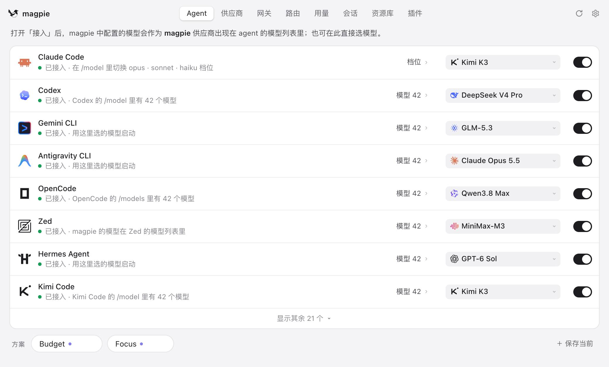
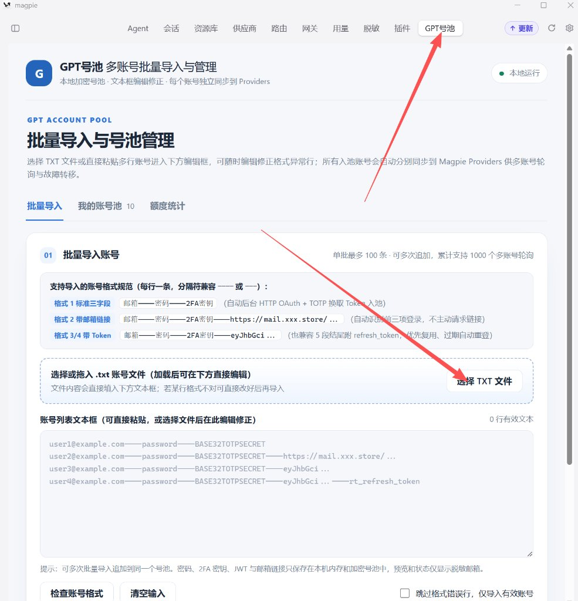

# Do It — 一句话搞定

> **用一句话完成一个任务，让小白也能感受到 AI 的魅力。**

不用记命令行、不用翻冗长的安装教程、也不用自己折腾环境报错。本项目收集真实可用的 **「一句话 AI 任务」** 案例——你只需要复制一句话发给支持操作电脑的 AI 助手（如 Antigravity、Claude Code、Cursor、OpenCode 等），剩下的交给它自动完成。

## 案例目录

| # | 案例 | 一句话指令 |
| :-: | :--- | :--- |
| 01 | [安装开源工具 Magpie](#01-安装开源工具-magpie) | `帮我安装https://github.com/yetone/magpie ，安装目录g:\tools` |
| 02 | [搭建 GPT 号池](#02-搭建-gpt-号池) | `https://github.com/yang0/magpie-gptfree 帮我把号池建起来。我的magpie目录： G:\tools` |

---

## 01. 安装开源工具 Magpie

**发给 AI 的一句话：**

```text
帮我安装https://github.com/yetone/magpie ，安装目录g:\tools
```

**截图：**



**简短说明：**

[Magpie](https://github.com/yetone/magpie) 是一款跨平台的本地 AI 模型网关与多 Agent 管理工具，能把 Claude Code、Codex、Gemini CLI 等数十款 AI 工具的模型配置集中到一处，点一下菜单栏即可切换模型、共享订阅账号并在额度用完时自动无感切换，还内置本地密钥隐私脱敏。以前小白在 GitHub 看到好用的开源软件，往往不知道该下哪个安装包、怎么解压和配置环境变量；现在只需把仓库地址和目标目录一句话发给 AI，它就会自动识别你的电脑系统、下载对应版本并安装配置到 `g:\tools`，全程不用自己动手。

---

## 02. 搭建 GPT 号池

**发给 AI 的一句话：**

```text
https://github.com/yang0/magpie-gptfree 帮我把号池建起来。我的magpie目录： G:\tools
```

**截图：**



**简短说明：**

[magpie-gptfree](https://github.com/yang0/magpie-gptfree) 是一款专为 Magpie 打造的多账号号池插件，支持把批量 GPT 普号直接粘贴或拖入 TXT 一键授权入池，自动同步到供应商列表实现多账号轮询与故障自动切换，还能实时查看每个账号的剩余生图额度，畅享聊天及 `gpt-image-2` / `gpt-image-2.6` 全系列文生图与改图能力，凭证全程加密保存在本机。小白不用自己研究插件怎么装、运行环境怎么配，只需把插件仓库地址和本地 Magpie 目录一句话发给 AI，它就会自动读懂项目文档并把号池插件安装配置到位，打开面板导入账号就能直接用。

---

## 一起共建：分享你的「一句话」

AI 最迷人的地方，不在于多复杂的提示词技巧，而在于你随口说出的一句话，真的帮你解决了一个实际问题。无论你是资深玩家还是刚接触 AI 的新手，只要你也有过 **「一句话让 AI 搞定一件事」** 的惊喜时刻，都非常欢迎分享出来，帮更多小白迈出第一步！

**欢迎 Fork 本仓库并提交 PR（Pull Request）：**

- 每个案例只需要三样东西：**发给 AI 的一句话** + **一张效果截图**（放入 `assets/` 目录）+ **一段简短说明**。
- 哪怕你以前从没提过 PR 也没关系——你甚至可以直接把本仓库链接发给你的 AI 助手，用一句话让它帮你 Fork、补充案例并提交 PR！
